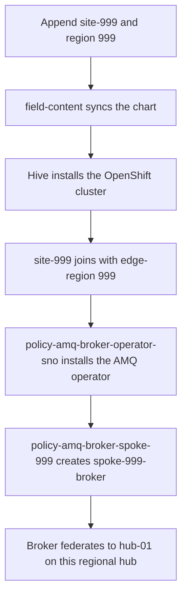

# Add a site to a regional hub

`999` in the diagram is a variable. Use your own value in every name.



A new edge site joins the regional hub you choose. That hub gets an AMQ broker for the site’s region, and the site broker federates to `hub-01` on that hub. The site does not join the Global Hub.

Log into the regional hub, not the Global Hub. `999` is a variable. Use the same value in the cluster name, the region code, and the broker name, and pick one that no other site on that hub already uses. This page writes it as cluster `site-999`, region `999`, broker `spoke-999`, and addresses `messages.999.*`.

## 1. You need three things

- The regional hub you are logged into.
- A cluster name that is free in your DNS zone: `site-999`.
- A region code no other site on that hub uses: `999`. Addresses for this site are `messages.999.*`.

One site of the size this chart installs needs 8 N2 vCPUs in the hub’s GCP region.

## 2. Add the site to the hub’s GitOps values

On the `field-content` Application in `openshift-gitops`, keep every site already listed and append one entry to each list. Set `spokeProvisioning.enabled` to `true`.

```yaml
spokeProvisioning:
  enabled: true
  clusters:
    - name: site-999
      region: "999"
edgeBrokers:
  - name: spoke-999
    region: "999"
    hubConnections:
      - hub: hub-01
        autoStart: true
```

Sync `field-content`. The chart creates the ManagedCluster, the label `edge-region=999`, the install-config secret, and the AMQ policy for this site. AMQ is not installed by that sync. It is installed after the cluster joins, as described below.

`./scripts/deploy-spokes.sh --clusters 2` only creates the demo names `sno-edge-01` and `sno-edge-02`. Use this page for any other name.

## 3. Install it

Skip a step that is already done on this hub.

Once per hub, create the ACM credential `gcp-credentials` in the namespace `gcp-credentials` (GCP service account, pull secret, SSH key pair, and your base domain).

Once per site, create the namespace and these secrets:

- `site-999-gcp-creds` — key `osServiceAccount.json`
- `site-999-pull-secret` — key `.dockerconfigjson`
- `site-999-ssh-private-key` — key `ssh-privatekey`

If `edge-broker-policies/hub-ca-truststore` is missing, create it from the hub service CA so the site broker can verify this hub’s AMQPS route.

Wait until the secret `site-999-install-config` exists. Then apply one Hive cluster, and leave it out of the Helm chart:

```yaml
apiVersion: hive.openshift.io/v1
kind: ClusterDeployment
metadata:
  name: site-999
  namespace: site-999
spec:
  baseDomain: example.com
  clusterName: site-999
  controlPlaneConfig:
    servingCertificates: {}
  installAttemptsLimit: 1
  installed: false
  platform:
    gcp:
      credentialsSecretRef:
        name: site-999-gcp-creds
      region: us-east1
  provisioning:
    installConfigSecretRef:
      name: site-999-install-config
    sshPrivateKeySecretRef:
      name: site-999-ssh-private-key
    imageSetRef:
      name: img4.22.12-x86-64-appsub
  pullSecretRef:
    name: site-999-pull-secret
```

Replace `example.com` with your base domain and `us-east1` with the hub’s GCP region. Wait until `spec.installed` is `true`. That takes about 30–45 minutes.

## 4. How AMQ is deployed, and when you are done

Hive only creates the OpenShift cluster. AMQ arrives from the regional hub’s ACM policies in the namespace `edge-broker-policies`. Those policies were rendered from the `edgeBrokers` entry you added. Nobody applies a broker manifest on the site.

After `site-999` joins with `sites=edge-sno` and `edge-region=999`:

1. Policy `policy-amq-broker-operator-sno` matches every site labeled `sites=edge-sno` and installs the AMQ Broker operator there.
2. Policy `policy-amq-broker-spoke-999` matches only `edge-region=999` and creates the broker `spoke-999-broker` in the `artemis` namespace. Its federation talks to `hub-01` on this regional hub. Traffic for this site uses `messages.999.*`.

Watch it from the hub:

```bash
oc get placement -n edge-broker-policies policy-amq-broker-spoke-999-placement
oc get managedcluster site-999
```

The placement should select 1 cluster. `site-999` should be Available, with labels `fleet=amq` and `edge-region=999`. On the site, `spoke-999-broker` is the running broker. The site is on this hub’s cluster list and later appears under this hub at the Global Hub.

This hub’s Argo CD does not yet list the new site, because placement `all-amq-sites` has no cluster-set binding. The broker still arrives through the ACM policies above. Do not add a binding by hand, and do not bind `ztp-policies`.
